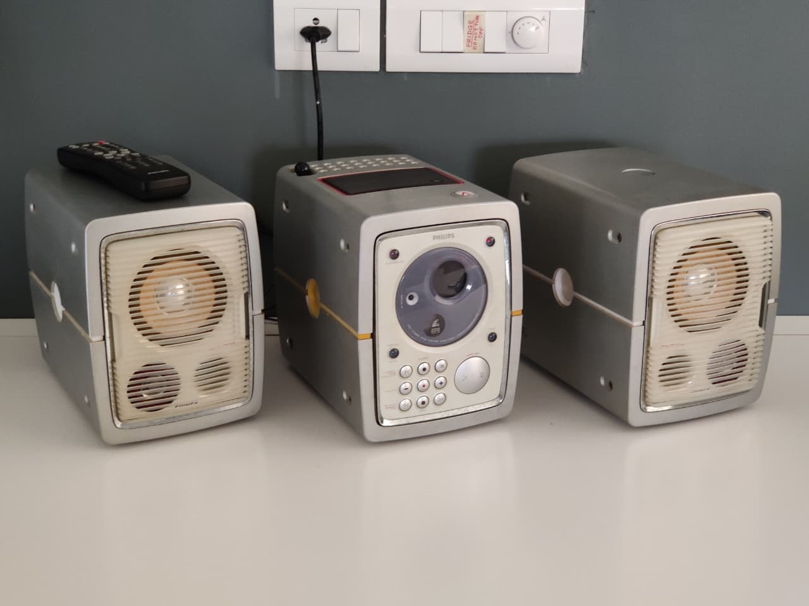
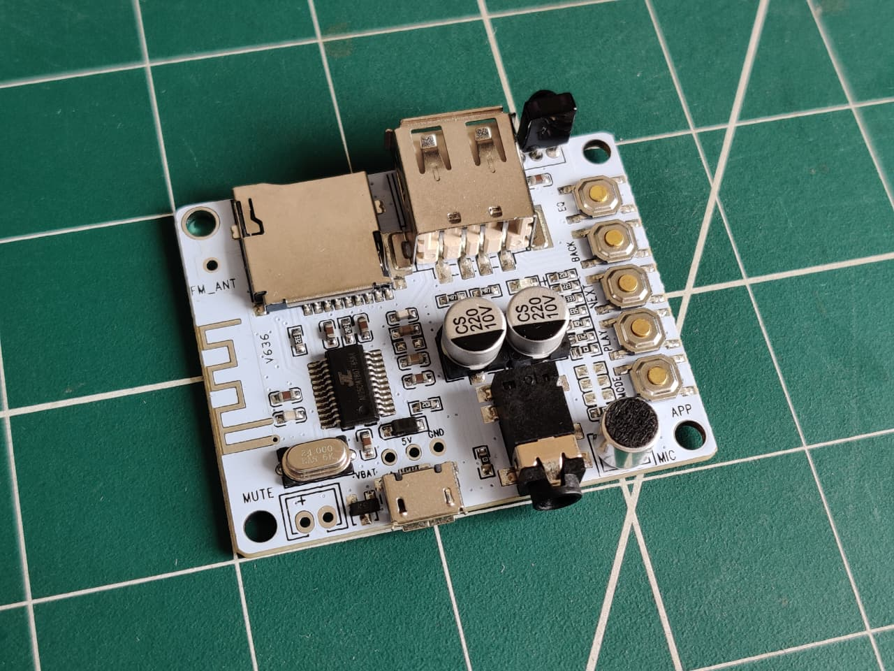

{: width="972" height="589" .w-50}
_Reassembled sound system, with a brand-new input method!_

## Introduction
We have an old Phillips V320 sound system that has served us well for well over a decade. However, given its age, it doesn't have support for Bluetooth audio input. This is a problem, as we generally play music from our phones, and there's no good way to pipe phone audio through the sound system. For a while, we've gotten around this by using Bluetooth speakers, but they're obviously lower-quality than a dedicated sound system.

However, among the various inputs the sound system has, one of them is a standard auxiliary input! It's wired to three RCA connectors to the back of the device. The sound system also has a CD reader, a cassette tape reader, and an FM radio, though we generally used it with an iPod Shuffle plugged into the auxiliary input.

Our original plan to add Bluetooth input to the sound system was to simply plug in an external Bluetooth receiver, but there were three problems that stopped us from doing so: 
1. A battery-powered module would need regular charging, and that's inconvenient since we plan to mount the sound system on a shelf that's hard to access.
2. An external module - powered through USB or similar - would need an external power brick, taking up space and a wall socket.
3. In either case, the module itself would need to need to be turned on separately, again,  inconvenient due to its position.

The solution we ended up settling on was to install a generic Bluetooth audio decoder inside the sound system itself, and power it from the sound system's own power supply. We didn't plan on using the sound system through anything other than Bluetooth, so soldering the output of the module directly to the RCA jacks that take in the auxiliary audio input - at the cost of not being able to use the auxiliary port again - was acceptable.

{: width="972" height="589" .w-50}
_Generic Bluetooth audio decoder_

The Bluetooth module I ended up getting is [this one](https://robu.in/product/amplifier-bluetooth-board-audio-with-usb-tf-card-with-microphone/), though the specific board doesn't matter - any board that can take in audio via Bluetooth and output it via an AUX cord should work.

 

## Disassembly
The sound system is split into three parts: A central control module, and two speakers. The control module's casing is... interestingly designed.

The main plastic shell is a clamshell-style design, with two parts that split in the middle. Inside, the electronics are mounted to a metal frame. Two metal rails also run horizontally, along the entire length of the unit. Both clamshells have small flanges, that screw into those rails. A small plastic trim covers up the gap in the middle of the two clamshells.

The front and back panels are both screwed into the internal metal frame. The front panel has the CD drive, a beautiful red alphanumeric display, buttons, and an IR receiver. The back has various connectors, for power and audio.

This design on its own is fine, however disassembly is made significantly harder by the fact that both clamshells clip into the internal metal frame. To remove the frame and the electronics, the only option is to pry the clamshell apart slightly while pulling the clamshell away. In addition, the plastic had grown brittle due to age, and a few flanges cracked while I tried to unscrew them.

 

## Internal Structure 
Once you're past all that, the internal electronics are quite clever. On the left side, near the bottom, a multi-tap transformer steps down the AC input. Mounted above it is the FM radio daughterboard. On the right side of the unit, the main motherboard is mounted. A series of voltage regulators and transistors are also bolted to a large metal heatsink, that sits inside a cavity in the back panel. A fan sits above it, pushing air over the fins. On a frame, suspended above the center, sits the cassette reader, with a panel on the top of the device that lets you access it. Near the front, the CD daughterboard is mounted. Connected to it is the front panel UI daughterboard.[^fpbuttons][^fpir]

TODO: photos

There's not a lot of free room inside the device, pretty much all of it is filled with PCBs and ribbon cables. The only spare spot I found to mount the Bluetooth module was on the heatsink, which has a large, flat, empty spot. Mounting additional things onto heatsinks is generally not a good idea, since the heatsink can get hot and damage the adhesive holding the module, or the module itself. However, in this case, I ruled it was fine since the components mounted onto it wouldn't generate enough heat to warm up the large and thick heatsink significantly.

Due to the problem mentioned in the next section, I ended up having to remove the Bluetooth audio module, and while doing so, I realized I could mount it onto the cassette reader's frame. I wanted to remove the cassette reader to repair it anyway. The reader hardware subassembly[^tapereader] sits on a plastic frame, which fits onto the metal frame at the bottom, and exposes an access panel at the top, through which you can insert or remove tapes.

 

## Power Supply Issues
Upon first opening the sound system, I didn't want to remove or fiddle about with things more than absolutely necessary, since I was worried about damaging it. Based on guesswork (and later confirmed via connectors), I knew that the device had +12VDC and +5VDC rails _somewhere_. I just needed to find and tap them, feed them into a USB connector, and then into the Bluetooth audio module. The least invasive way I decided to try first was the cooling fan. It's essentially a standard PC fan, and runs off of 12 volts. I spliced my own cables into the fan's power cable, fed it into a 7805, cut up an old USB cable to harvest its Micro-USB end, and plugged it into the module.

The astute reader may have already noticed a major flaw with this plan that I completely missed: The fan's power rail is _VERY_ noisy. That noisy voltage gets fed to the Bluetooth audio module, and manifests as a lot of noise in its audio output.

...Yeah, I should have seen that sooner. In my defense, I don't work with audio much. :P

Anyway, I ended up cutting my losses and fiddling about more. Conveniently, the V320 is old enough to use primarily through-hole components, and it's easy to follow traces and read chip numbers. I ended up figuring out that all of the DC voltages the module needs (+12VDC, +5VDC, -5VDC) are generated by linear voltage regulators, whose TO-220 packages are bolted to the heatsink. 

At this point, I had a suspicion that the voltage rail itself might be noisy, contrary to my earlier assumption of the fan injecting noise back into the +12VDC line. To quickly test this, (without removing my careful heat-shrink/hot-glue package for my dead-bug-soldered 7805 and capacitors), I moved the input to my 7805 from the fan's rail to the filtered output of the 7812 on the motherboard. My suspicion was proven correct, the noise in the Bluetooth module's output still existed.

...Well, onto my third - and last - plan. The only solution I could think of that could avoid all possible noise or interference. Simply use a completely different power supply for the Bluetooth module, and feed it from the AC input that the V320 gets.

I have a collection of power supplies of various voltages, currents, sizes, and packages. I ended up going with an awkwardly-shaped USB charger, which I wasn't likely to use anywhere else. As a bonus, it was also really weak, only outputting 500 milliamps (the bare minimum of the USB spec!). I tried out a new technique[^pswiring] for attaching wires to the plug pins directly, rather than opening up the power supply. I then soldered these wires to the pads where the AC input cable is soldered. The most sensible place I could figure out for the awkwardly-shaped power supply ended up being the heatsink, taking the place of the Bluetooth module. I moved the Bluetooth module to the cassette reader's frame, and it can be accessed by opening the cassette reader's top access panel. As a bonus, since nothing's soldered directly to the Bluetooth module, we can unplug the audio jack from it, and connect it to something else, if we ever end up needing to send audio directly to the sound system.

TODO: photos

 

## Finished Device
After carefully tetris-ing the internals back onto their frame, wrapping it in the clamshells, and screwing everything back together, the sound system was ready for use. The only changes in terms of UX were:
1. Cannot use the RCA connectors on the back, auxiliary audio needs to be sent through the internal 3.5mm jack instead.
2. No cassette reader.

I think it turned out quite well. We've used the sound system for about two weeks by now, and it's been working perfectly fine.

 

## Additional Photos
TODO

 

## Footnotes and Additional Links
[^tapereader]: The cassette reader included with the V320 is pretty fancy, featuring a dual-track player, done in an interesting way: the read head flips upside-down, and the tape is fed backwards, onto the supply spool. Due to age, the spinning reader head mechanism had gotten sticky, and didn't reliably move. Additionally, due to other mechanical issues, the reader had a tendency to chew up tapes fed to it. I plan on reverse-engineering and maybe repairing the cassette reader some day.

[^fpbuttons]: The front panel buttons need to be pressed quite aggressively to register a press. I presume they're corroded. The panel to which they're mounted is a door, that folds downwards to allow you to insert a CD onto the platter. The door appears to be clipped together, since I couldn't easily remove it after removing the only screws it appeared to have. The door also has the alphanumeric UI display, which is necessary for controlling the device, so I was hesitant to try and pry any potential clips apart. The buttons are not strictly necessary, since the IR remote can do everything they're used for, but I'd like to eventually clean them.

[^fpir]: The included IR remote is... very annoying. Right now, it's the only way we have to interact with the sound system. However, it appears to be using a proprietary modulation scheme, the IR decoder I normally use (which has been able to decode every other IR remote I've pointed at it) isn't able to read anything. Given the system's age, if the remote breaks, I doubt I'd be able to get or make a replacement. I've tried searching, but I haven't been able to find an original remote, or any remote claiming to be compatible with the system. There are several Android/iOS apps which claim to support "All Phillips devices" or the like, but I haven't been able to confirm that. None of them explicitly mention sound systems, or the V320.

[^pswiring]: The plug pins have holes, through which you can pass the stripped end of a wire. In most cases, you can't solder to the pin themselves, but you can flood the hole with solder, locking the wire in place. Then, you can slide a length of heat shrink tubing over the entire pin, safely insulating it. For obvious reasons, be careful if you attempt this technique for yourself. Though, to be fair, if you're reading a technically-inclined blog about hardware hacking, I'm sure you know your way around high voltage AC :P